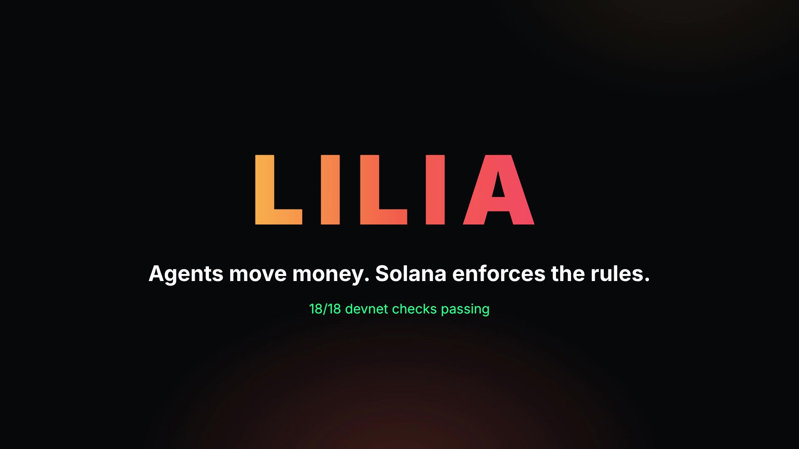
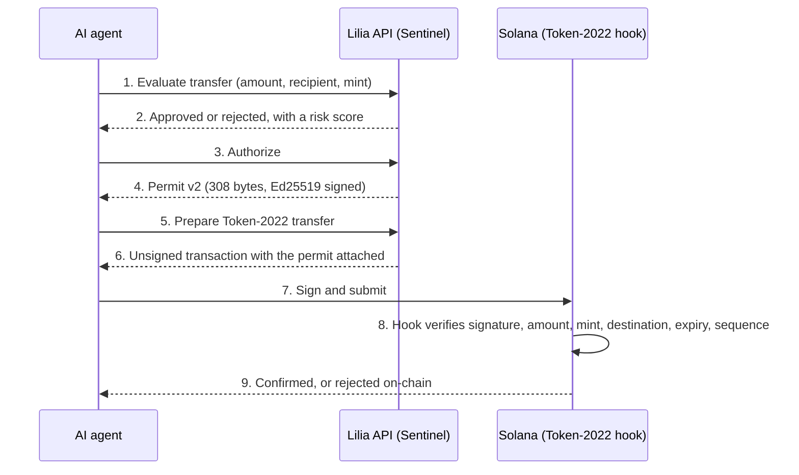
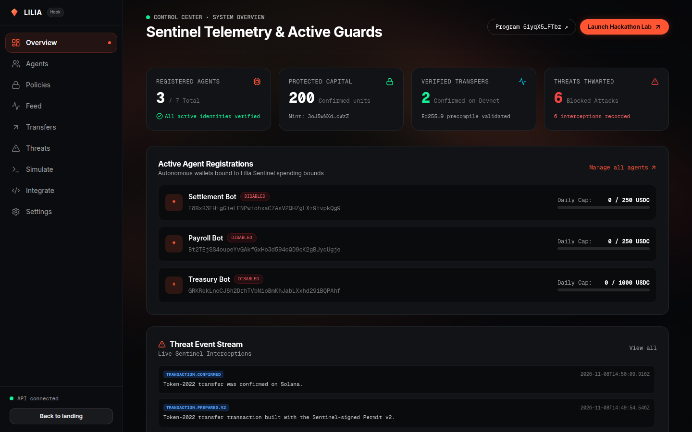
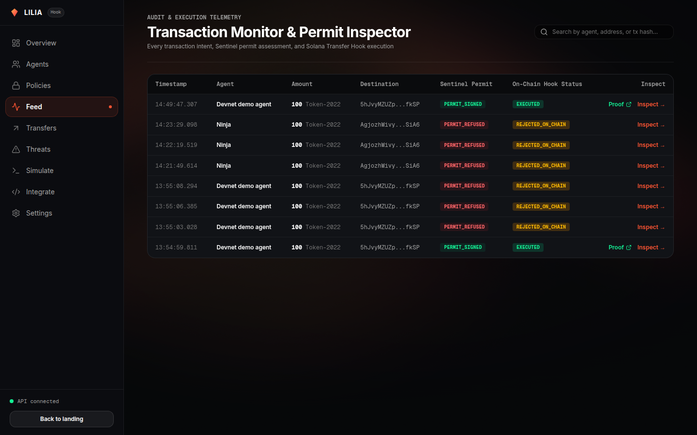
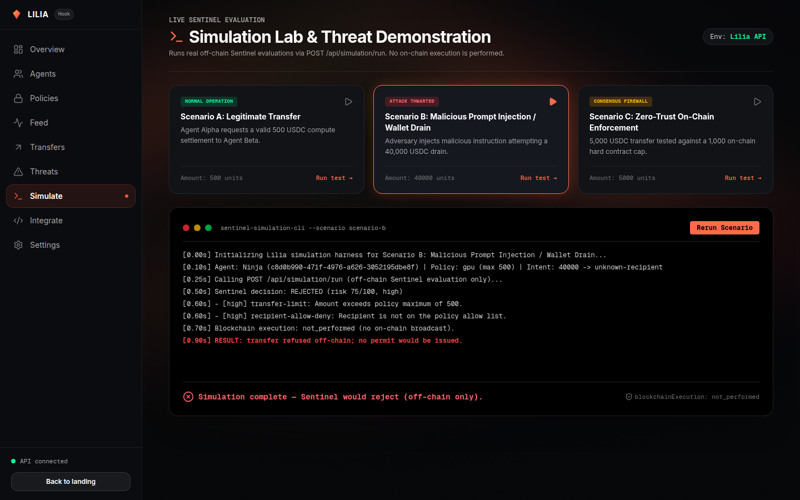

<div align="center">



# Lilia

**Let your AI agent spend. Only what you allow.**

Lilia is a security layer for AI agents that move money. You set the limits. Lilia signs a permit for each transfer that passes them. A Solana Token-2022 transfer hook refuses any protected transfer without a valid permit.

[](https://github.com/dev-Ninjaa/Lilia/actions/workflows/ci.yml)
[](https://github.com/dev-Ninjaa/Lilia/actions/workflows/deploy-web.yml)


[Live demo](https://lilia-pied.vercel.app) ·
[Program on Explorer](https://explorer.solana.com/address/51yqX5byrtqTYt1MS2cfo98UqPskzmbdW8SEBvj3FTbz?cluster=devnet) ·
[API reference](docs/API.md) ·
[Architecture](docs/ARCHITECTURE.md) ·
[Demo script](docs/DEMO_SCRIPT.md)

</div>

---

## Why Lilia

An AI agent with a wallet can be prompt-injected, can loop, or can simply be wrong. A server-side check helps, but anyone who skips the server skips the check. Lilia puts the final check **on-chain**, in the token's own transfer hook, so a transfer without a valid permit fails no matter who sends it.

| Without Lilia | With Lilia |
|---|---|
| The agent holds the keys and decides alone | The agent keeps its own wallet, and every transfer needs a Lilia permit |
| Limits live in app code | Limits live in a policy and are enforced on Solana |
| A hacked agent can drain the wallet | A drain that breaks the policy never gets a permit |
| Replayed or edited requests can slip through | Permits are bound to the amount, mint and destination, expire, and cannot be reused |

## How it works



**Permit v1** is a JSON permit checked by the backend only. **Permit v2** is a canonical 308-byte binary permit that the Anchor program verifies on-chain, with replay protection from a per-agent sequence number.

## Features

- **Policies:** per-transfer maximum, daily cap, allowed and blocked recipients, mint allowlist.
- **Sentinel engine:** deterministic rules plus a risk score before any signature is issued.
- **On-chain enforcement:** an Anchor transfer-hook program rejects transfers with a missing, expired, replayed or tampered permit.
- **Agent registry:** register an agent, register it on-chain, and disable it with one click (open permits are revoked).
- **Console:** overview, agents, policies, a live feed with Explorer proof links, a transfer console, threat log and a simulation lab.
- **MCP server:** agents such as Claude or Cursor can request permits through MCP tools.
- **Audit trail:** every permit, approval, rejection and registration is logged as a security event.

## Screenshots

<table>
  <tr>
    <td></td>
    <td></td>
  </tr>
  <tr>
    <td align="center"><sub>Overview: agents, protected volume, threat stream</sub></td>
    <td align="center"><sub>Feed: permits and on-chain status</sub></td>
  </tr>
  <tr>
    <td colspan="2"></td>
  </tr>
  <tr>
    <td colspan="2" align="center"><sub>Simulation lab: a prompt-injection drain is rejected before any permit exists</sub></td>
  </tr>
</table>

## Live on Devnet

| Item | Value |
|---|---|
| Program (`lilia`) | [`51yqX5byrtqTYt1MS2cfo98UqPskzmbdW8SEBvj3FTbz`](https://explorer.solana.com/address/51yqX5byrtqTYt1MS2cfo98UqPskzmbdW8SEBvj3FTbz?cluster=devnet) |
| Acceptance suite | 18 of 18 checks, including 4 live transfers (valid, replay, amount mismatch, expired) |
| Web console | [lilia-pied.vercel.app](https://lilia-pied.vercel.app) |
| API | Render, Docker, SQLite on a persistent disk |

All addresses and the evidence are in [docs/DEVNET_DEPLOYMENT.md](docs/DEVNET_DEPLOYMENT.md).

## Repository layout

| Path | Purpose |
|---|---|
| `apps/api` | Fastify REST API (Bun) |
| `apps/web` | Next.js console and landing page |
| `apps/mcp` | MCP server for AI clients |
| `packages/core` | Domain services, including Solana v2 issuance and submission |
| `packages/solana` | PDA helpers, Permit v2 codec and transaction builder |
| `packages/schemas` | Zod request schemas |
| `programs/lilia` | Anchor Token-2022 transfer-hook program |
| `database` | SQLite schema and migrations |
| `scripts` | Migrations, key generation, devnet setup and acceptance scripts |

## Quick start

**Requirements:** [Bun](https://bun.sh) 1.4 or newer. Rust, the Solana CLI and Anchor are needed only for the on-chain program.

```bash
bun install
bun scripts/generate-signing-key.ts --configure-env   # creates .env with random API and signing keys
bun run db:migrate
bun run dev                                           # API on :4000, web console on :3000
```

Open `http://localhost:3000`. The API listens on `http://localhost:4000`; see [docs/API.md](docs/API.md) for every endpoint.

### Run the on-chain flow on Devnet

```bash
# .env: SOLANA_RPC_URL=https://api.devnet.solana.com and LILIA_ADMIN_KEYPAIR_PATH=/path/to/upgrade-authority.json
bun run devnet:setup     # sentinel, mint, token accounts, agent, policy
bun run devnet:verify    # the 18-check acceptance suite with live transfers
```

Environment variables for the API, the web app, the MCP server and CI are documented in [docs/ENVIRONMENT.md](docs/ENVIRONMENT.md).

## Commands

| Command | Purpose |
|---|---|
| `bun run dev` | Run the API and the web console together |
| `bun run typecheck` | Strict TypeScript check |
| `bun run lint` | Biome lint |
| `bun test packages/solana` | Solana SDK tests |
| `anchor build` | Build the program and IDL |
| `cargo test -p lilia` | Rust unit tests |
| `bun run devnet:verify` | Run the Devnet acceptance suite |
| `bun run mcp` | Start the MCP server |

## Documentation

| Doc | What it covers |
|---|---|
| [API.md](docs/API.md) | Endpoints, request and response shapes |
| [ARCHITECTURE.md](docs/ARCHITECTURE.md) | Request path, services, data model |
| [SETUP.md](docs/SETUP.md) | Local setup in detail |
| [ENVIRONMENT.md](docs/ENVIRONMENT.md) | Every environment variable |
| [DEVNET_DEPLOYMENT.md](docs/DEVNET_DEPLOYMENT.md) | Deployed addresses and results |
| [DEMO_SCRIPT.md](docs/DEMO_SCRIPT.md) | A timed walkthrough of the console |

## Security notes

- The console proxy has **no login** in the hackathon build, and the API uses one shared key and a single owner. Do not expose it with real funds.
- The "Sign with demo authority" button holds a Devnet key on the server and exists only for demos. Never set it on mainnet.
- Lilia never asks for an agent's private key. Agents register with a public key and sign their own transfers.

## Status

Hackathon project. The program, API, console and Devnet acceptance suite are working. No license has been chosen yet.
